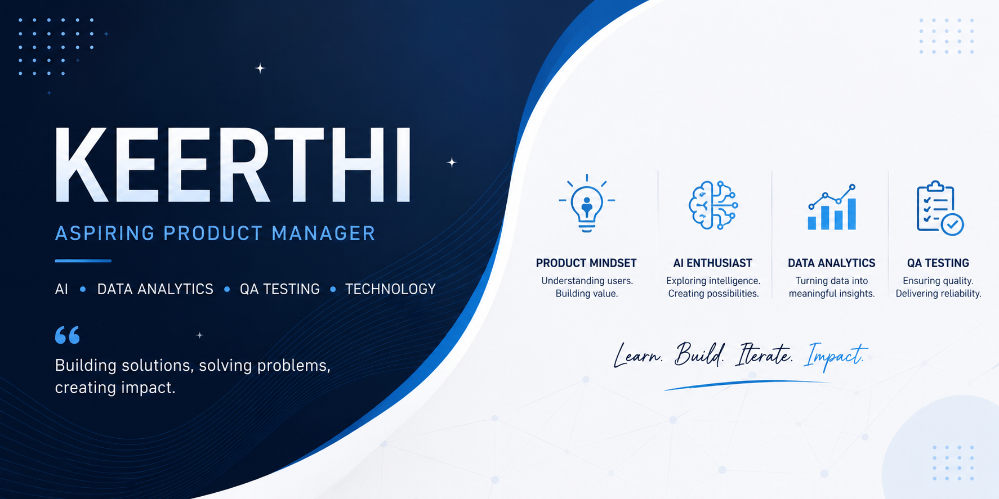

```html
<p align="center">
  
</p>

<h1 align="center">Hi 👋, I'm Keerthi</h1>

<h3 align="center">
Software Development | Data Analytics | Artificial Intelligence
</h3>

<p align="center">
Building practical solutions through code, data, and intelligent technologies.
Interested in solving complex problems, uncovering meaningful insights,
and developing reliable, user-focused applications.
</p>

<p align="center">
📍 India • 🎓 Engineering Student • 💻 Technology & Innovation
</p>

---

## 👩‍💻 About Me

- 🎓 Engineering student with an interest in software and data-driven solutions
- 💻 Exploring software development, application design, and problem-solving
- 📊 Working with data to identify patterns, generate insights, and support decisions
- 🤖 Exploring AI-powered applications and Generative AI technologies
- 🛠️ Building projects that combine technical implementation with practical use cases
- 🤝 Open to collaborating on software, analytics, and AI-driven projects

---

## 🛠️ Skills & Technologies

<p align="center">
  
</p>

### Programming & Development
- Python
- Java (Basics)
- HTML, CSS & JavaScript (Basics)
- API Integration
- Git & GitHub

### Data & Analytics
- SQL & Database Fundamentals
- Data Analysis & Interpretation
- Data-Driven Problem Solving
- Analytical Thinking

### AI & Emerging Technologies
- Generative AI & LLM Fundamentals
- Prompt Engineering
- AI API Integration
- Conversational AI Applications

### Tools & Platforms
- VS Code
- GitHub
- Streamlit
- Supabase (Basics)

---

## 🚀 Projects & Practical Work

- 🤖 **AI-Powered Applications** — Exploring intelligent applications using AI models and APIs
- 📊 **Data-Driven Solutions** — Applying analytical thinking to understand problems and extract insights
- 💻 **Software Projects** — Developing applications with a focus on functionality, usability, and problem-solving
- 🔍 **Continuous Improvement** — Refining projects through experimentation, debugging, and iteration

---

## 🎯 Areas of Focus

- Software Development & Engineering Principles
- Data Analytics & SQL
- Problem Solving & Logical Thinking
- Artificial Intelligence & Generative AI
- Application Development & API Integration
- Data-Driven Decision Making
- Code Quality, Testing & Debugging

---

## 🌐 Connect With Me

<p align="left">
  <a href="https://www.linkedin.com/in/bhuvana-sri-keerthi-maringanti-263957297/">
    
  </a>
</p>

📧 Email: bhuvanakeerthimaringanti@gmail.com

---

## 📈 Profile Visitors

<p align="center">
  
</p>

---

<p align="center">
  <i>Think critically. Build thoughtfully. Learn continuously.</i>
</p>
```
